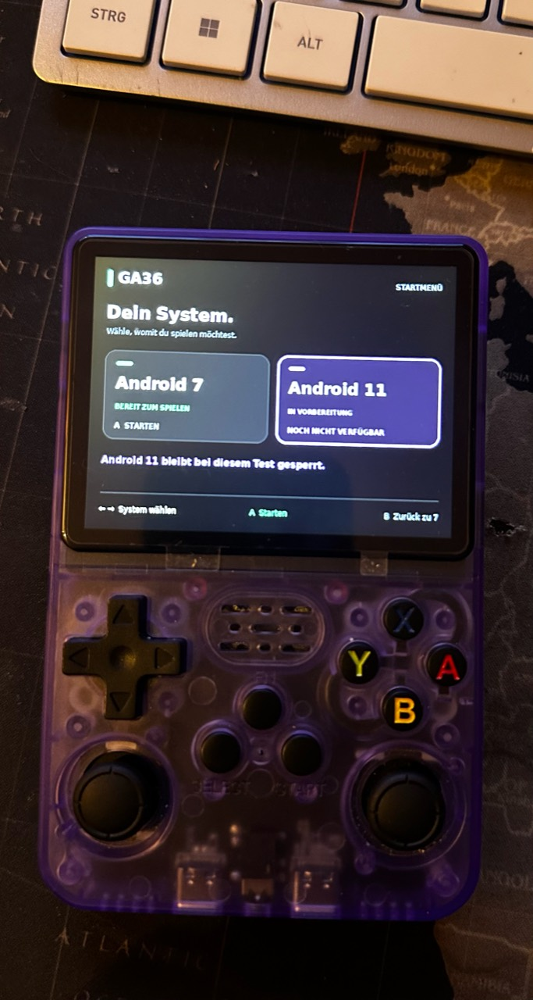

# GA36 Android

I'm developing an experimental Android port for my R36S-style handheld with a **GA36-MB V1.2-20260416** board. I started with Android 5.0, moved through Android 6 and 7, and now have **Android 11 booting on the handheld**, alongside my preserved Android 7 setup. **The experimental dual-boot setup offers Android 7 and Android 11; switching between them currently requires a restart.**

I develop this project **with AI assistance**. I use AI tools to help analyse firmware, write and adapt code, investigate problems and prepare documentation. I test changes on my own device. Below I distinguish device results, my latest test feedback and local build/emulation checks.

**This is an experimental project for one tested board revision. No ready-to-flash image is available here.** The README and current progress report are in English for international readers; some on-device UI labels are still German.

## Android 11 on my handheld


*User-supplied Android 11 test photo showing Settings on the device. I have now confirmed that Settings navigation works. This is not a full test of every settings feature.*

<details>
<summary>Android 11 startup and launcher photos</summary>


*Boot branding and the startup screen. These images show stages of startup, not completion by themselves.*


*The GA36 launcher with an installed-game tile visible. The photo documents the launcher; it does not establish successful launch/gameplay. No game APK, game data or standalone game artwork is distributed with this repository.*

</details>

The photographs are supplied as Android 11 device-test photos. They do not independently identify the exact P23 build; current version information is based on installation records and test feedback.

## Current status — 10 November 2026

| Area | Current evidence and limits |
| --- | --- |
| Android 11 | **P23 installed and directly readback-verified**, using my source-built **K09 kernel, Linux 3.4.39 #80**. I report that Android 11 boots/runs. Detailed logs confirm earlier P22 framework/GUI startup; fresh P23 runtime logs are still pending. |
| Settings | The P23 focus correction was built and inspected. **I now confirm Settings navigation works on the device.** This does not certify every setting. |
| Right-stick mouse / R1 | **Still not working.** P23 includes a locally tested legacy-uinput short-write correction, but I still see no mouse reaction. The cause needs further device diagnosis. |
| Launcher / display | Android 11 launcher and Settings are visible in the supplied photos. Complete graphics, controls, sound and long-running stability acceptance remains open. |
| Android 7 | Preserved with the **D04 kernel #72**. Its boot/system contents and existing user data were protected during the P23 installation. |
| Memory | **256 MiB zRAM and 4 GiB SD swap** were active in the last detailed P22 device test. Both showed zero usage in that snapshot. Physical RAM remains 512 MiB; this is not a performance benchmark. |
| P24 | Planned input diagnosis, measured performance work and boot-menu improvements. **No P24 implementation, build or installation is claimed.** Development is paused at my request; this update changes documentation only. |
| USB / secondary SD | PC USB, OTG hub/flash-drive support and the second SD slot remain unconfirmed/deferred. Direct OS startup without an additional restart is also deferred. |
| TWRP | Optional and paused. It is not required for the planned SD-card installation/recovery route. |

The Android 11 entry is no longer merely the locked preparation placeholder shown in the old V69 report: Android 11 has since booted on the device. OS switching still uses the existing restart-based test mechanism. I am not presenting this as a finished or universally compatible dual-boot release.

**Known remaining issues:** the mouse is unresponsive; the last P22 logs contain DocumentsUI/external-storage hangs. Audio, gameplay, repeated Power/wake and complete control regression on P23 are not all confirmed by the general “runs” report. Fresh P23 logs are needed to assess those areas.

See the [current P23/K09 progress report](docs/updates/2026-11-10/p23-k09-status.md) and [curated current status](docs/updates/2026-11-10/latest-status.json). Older dated reports describe earlier states and are not current acceptance records.

## My hardware

Runtime analysis identifies my board as **Allwinner A33 with 512 MiB RAM**. The photographed chips have Rockchip markings, which differ from that runtime identification. I have tested one **GA36-MB V1.2-20260416** board; other revisions and handhelds are not validated by this work.

## Kernel work — runtime progress, packages still local

Android 11 currently uses my source-built **K09 #80** kernel. The latest installation reuses that kernel; prior P21/P22 device records confirm it boots. Android 7 retains **D04 #72**. The kernel work includes Android compatibility changes, with static interface checks for 377 imports across five board modules. Some vendor modules remain retained for local testing.

Booting a kernel does not establish complete input, graphics, audio, security or suspend/wake correctness. Full source/build packages remain local for now, as previously requested; I am only documenting the progress here. Source and redistribution work for retained components remains open.

## BusyBox preparation — local only

A separate static ARM BusyBox 1.36.1 replacement has sources, configuration, changes and license notices prepared locally. Seventeen ARM-emulation checks passed, including legacy `timeout -t` compatibility, and its saved build recipe produced a second working local build. Integration of that candidate into the current P23 system is not established by these results.

## What is published here

Much of the original implementation comes from the earlier Android 5 bring-up:

- `src/ga36-pointer.c`: ARM32 evdev-to-uinput mouse helper from that earlier stage.
- `src/lights-ga36.c`: experimental Android 5 backlight HAL.
- `src/test-kernel-branches.c`: isolated Power-event branch test.
- `config/`: selected input mappings and policy.
- Dated Android progress reports, curated evidence summaries, hardware photos and a labelled historical menu illustration.

**The published source files are not a complete representation of the current P23 implementation.** In particular, the older pointer source must not be described as a working Android 11 pointer solution. Full Android 11 integration, kernel packages, system images and recovery implementation are not published here.

No stock firmware, full card images, Android images, game APKs/data, private keys or raw device logs are added by this update. The launcher photograph includes a visible game tile; it is a test photo, not distribution of the game.

## Release preparation

My next work is to diagnose the remaining mouse failure, capture fresh P23 logs, measure performance and improve the boot-menu/test flow. Settings navigation is now device-confirmed, while broader system acceptance remains open. P24 is still a plan.

A public image also requires complete source/license preparation, a clean image without private/game data, installation/recovery instructions and validation on another card. Existing Mali/audio/boot components remain technically retained; missing matching redistribution/source evidence is not treated as a grant. MIT is selected for my original code only; imported material keeps its own terms. See the [release roadmap](docs/release-readiness.md) and [NOTICE](NOTICE.md).

## Development reports

- [Current P23 / K09 update — 10 November 2026](docs/updates/2026-11-10/p23-k09-status.md)
- [Current curated status](docs/updates/2026-11-10/latest-status.json)
- [Earlier V69 / D03 and Android 11 preparation snapshot](docs/updates/2026-11-08/v69-d03-status.md)
- [Earlier source and BusyBox review](docs/updates/2026-11-08/source-and-validation-update.md)
- [Earlier V65 progress](docs/updates/2026-11-08/progress-update.md)
- [Android 7 bring-up report](docs/updates/2026-11-06/progress-update.md)
- [Historical V39 kernel checks](docs/updates/2026-11-06/kernel-v39-checks.json)
- [Historical TWRP status](docs/updates/2026-11-06/twrp-status.json)

## Earlier Android 7 and hardware photos

These are photos of my test handheld and board, not rendered mockups. The Android photos were taken on 6 November 2026 and do not identify or validate every later build.


*Android 7.0 running on the GA36 handheld, using the vendor kernel shown on screen.*

<details>
<summary>Memory view and board photos</summary>


*Memory settings during that test: about 496 MB reported total, 304 MB average use and 191 MB free. This is a snapshot, not a performance benchmark.*


*Both sides of my GA36-MB V1.2-20260416 board. Printed chip markings differ from the runtime platform identification described below.*

</details>


## Historical menu illustration

<details>
<summary>Earlier V69 preparation menu, with Android 11 still locked at that time</summary>



*This user-supplied illustration describes the earlier preparation stage. It is not the current Android 11 availability status and is not runtime evidence.*

</details>

## Publication checks and attribution

I keep publication separate from my full local working directory. `PUBLICATION-MANIFEST.json` records the reviewed files. `tools/check-publication.py` verifies the file list, UTF-8/JSON text, explicitly reviewed JPEG images, sizes and SHA256 hashes, rejecting extra files and symlinks while excluding root `.git` metadata.

```sh
python3 tools/check-publication.py
```

The manifest is not signed, and this check is not legal clearance or an exhaustive secret scan. See [NOTICE.md](NOTICE.md) for provenance and licensing scope. The MIT choice for original code is not a blanket license for imported firmware or photographs.

## Related post

[My Reddit post](https://www.reddit.com/r/R36S/comments/1xomg76/comment/19s6oe904jeyt/)
