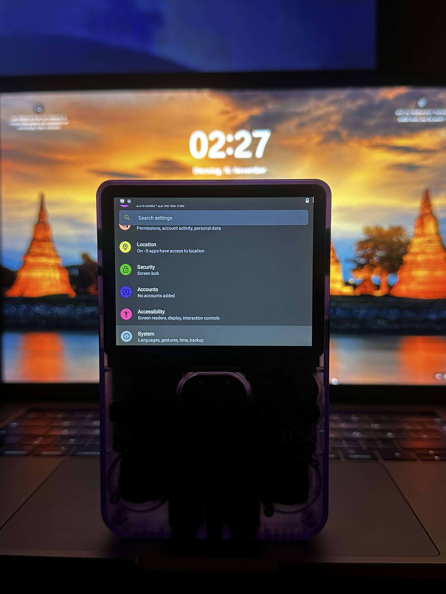
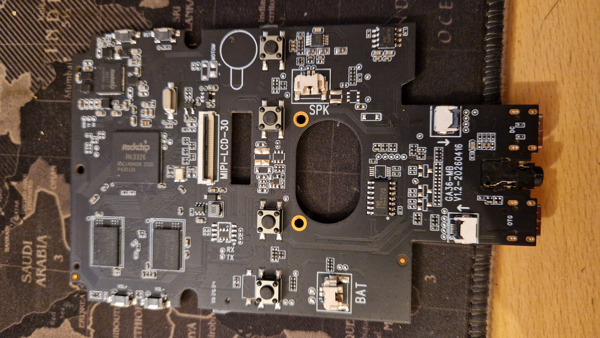
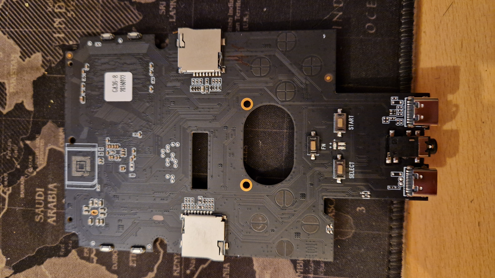
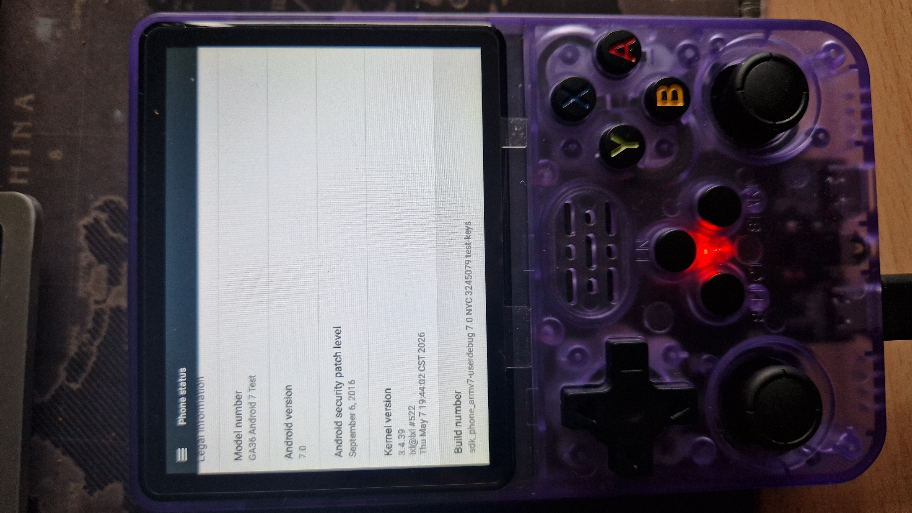
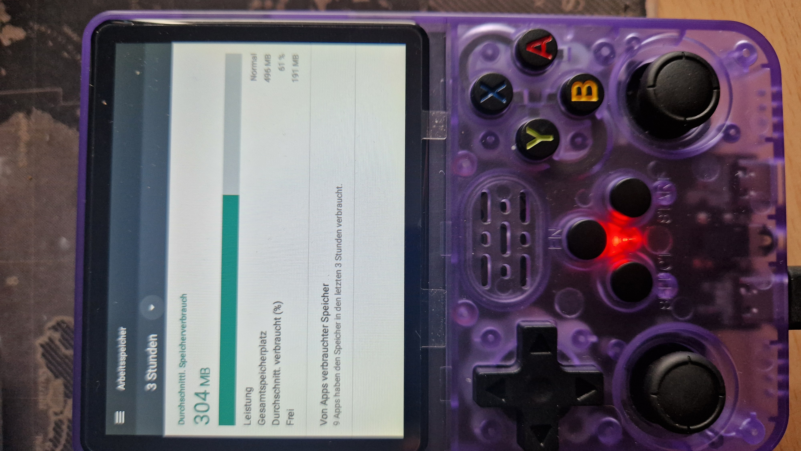
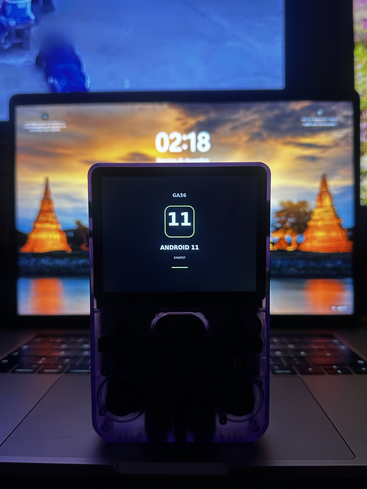
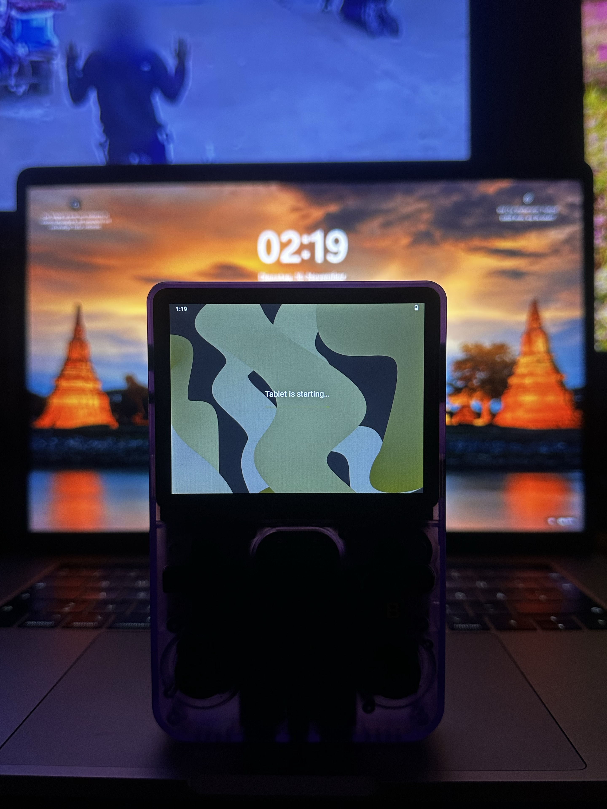
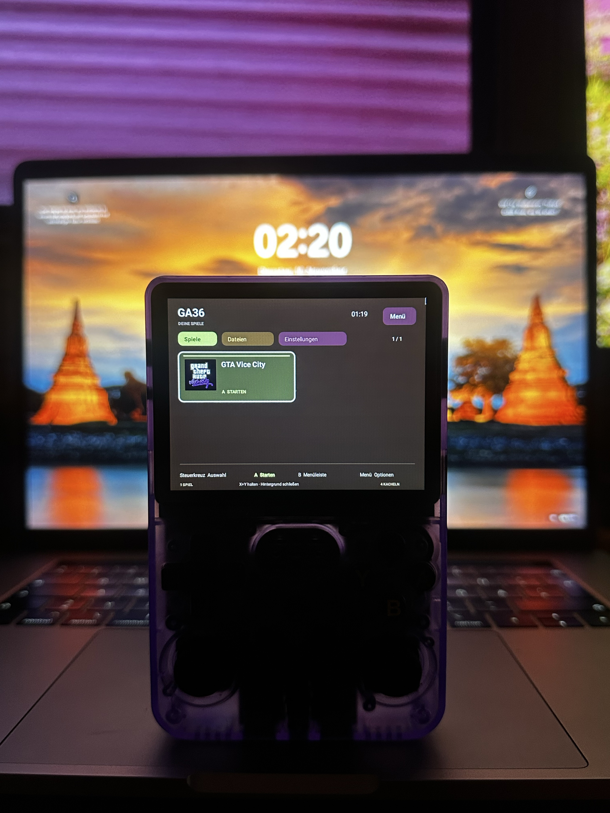

# GA36 Android — my R36S clone development

Experimental Android development on my **GA36-MB V1.2-20260416** board, a
**R36S-style clone** identified at runtime as **Allwinner A33 with 512 MiB RAM**.
This is a record of my own device and tests. Compatibility with other R36S
boards, clones or revisions is not established.

I develop the project with AI assistance and test it on my handheld. Device
feedback, saved logs and host/build checks are distinguished below.

## Current status — 12 November 2026

The existing **P39 / K11 #82 dual-boot device setup runs GA7 and GA11**. GA7 is
Beta V1; GA11 is Alpha V1. The latest owner feedback confirmed GA11 sound and
GTA trailer playback, and no longer observed the earlier GTA exit crash.

**The separate clean images failed the owner's boot test.** They are no longer
recommended. An English clean **GA7 + GA11 dual-boot replacement for 64 GB or
larger cards** is complete locally and **ready for the device test**. It keeps the
original bootloader prefix, shared kernel and storage offsets, with fresh data
for both systems and no games, saves or user accounts. Both ROMs, the launcher,
boot menu and boot animations default to English. Each userdata filesystem
begins at 24 GiB. The minimum card size is 63,909,658,624 bytes.

The compressed image is 995,126,132 bytes (about 949 MiB). Complete
decompression, SHA-256, filesystem and component-region checks pass. These
checks establish host integrity; fresh-card boot and larger-card growth still
need the handheld test.

Native Linux flasher **4.1-dual** adds the preserved dual layout and refuses
marked failed images. The initial public flasher release remains **Linux only**.
A Windows CMD version is a private test build; Windows runtime/writing is pending.
The old APK/OBB inbox supports older GA36_APPS cards; the new dual layout has no
such FAT area, so that transfer path still needs work. USB and slot 2 are deferred.

[Current dual-boot report](docs/updates/2026-11-12/clean-dual-boot-status.md) ·
[Current status JSON](docs/updates/2026-11-12/latest-status.json) ·
[Release readiness](docs/release-readiness.md) ·
[Device test plan](docs/updates/2026-11-12/device-test-plan.md)

No Android image is published here. Fresh-card first boot, larger-card growth,
repeated sleep/wake and memory-pressure regression remain to be tested.

## Personal development here; public releases separately

This repository remains my development journal for the exact board above.
A separate **R36S-Clone-GA36-Android-Releases** project is being prepared for
community source work, build instructions and eventual GA7/GA11 releases.
It has not yet been created or published. Source and release packages are
being collected locally; no ROM upload is part of this status update.

The new clean dual-boot candidate has fresh userdata and removes bundled game
packages and launcher game artwork. Retained vendor/boot components still need
matching source/provenance work before a public ROM release.

## Native Desktop Flasher 4.1-dual candidate

The new flasher uses **its own Win32/X11 desktop window**, without a browser,
WebView or local web server. The local update supports the original GA7/GA11
dual layout and SHA-256 checks, with complete write/readback verification.
**34 host tests pass**; the actual clean image is recognized in the isolated
DE/EN native GUI test. Physical writing of this new package remains untested.

APK/OBB queueing and INSTALL.TXT reading apply to older GA36_APPS cards. The
new dual image has no such FAT inbox, so this transfer route still needs work.
USB-to-PC remains unresolved. No ROM is included in the flasher package.

The native package remains local while release preparation continues. The first
planned binary release is **Linux only**. Windows is deferred. The owner reports
that the Linux flasher works; this does not certify every physical-card action.

[Earlier browser-based GUI tool](tools/flasher/README.md) — historical version,
with simulated-card screenshots and no Android image. Its earlier Windows
feedback does not validate the new native write path.

## My handheld and board



*Owner-supplied device-test photograph from the earlier Android 11 work. It does
not identify or validate the current P39 clean image by itself.*

<details>
<summary>Device, board and earlier startup photographs</summary>




Printed chip markings differ from the Allwinner runtime identification.







The launcher photo includes an installed-game tile; no game package or data is
provided. Memory photos are snapshots, not current performance benchmarks.

</details>

## Sources and history

Published `src/` and `config/` files still include early Android 5 bring-up
code. They are not a complete source representation of the current P39/K11
integration. Current kernel, Android integration, launcher and native boot
sources are being assembled for the separate source/release project.

- [Clean dual-boot replacement — 12 November](docs/updates/2026-11-12/clean-dual-boot-status.md)
- [P39 / K11 — 11 November](docs/updates/2026-11-11/p39-k11-status.md)
- [P23 / K09 — 10 November](docs/updates/2026-11-10/p23-k09-status.md)
- [V69 / D03 preparation](docs/updates/2026-11-08/v69-d03-status.md)
- [Earlier source and validation review](docs/updates/2026-11-08/source-and-validation-update.md)
- [Earlier Android 7 bring-up](docs/updates/2026-11-06/progress-update.md)

Historical reports are retained as dated evidence; their pending flags do not
override the current report. The old menu illustration is also historical:
[earlier system-selection illustration](assets/illustrations/system-selection.jpg).

## Publication scope and attribution

[NOTICE.md](NOTICE.md) records provenance and licensing boundaries. MIT is
selected for original project-owned code only; third-party source, drivers,
firmware and photographs retain their own terms. No signing private key,
account data, raw device log or game package is added by this update.

`PUBLICATION-MANIFEST.json` pins the reviewed repository files. To check them:

```sh
python3 tools/check-publication.py
```

This checks the file set, hashes and selected content; it is not a signed
release or a legal/security clearance.

[Related Reddit post](https://www.reddit.com/r/R36S/comments/1xomg76/comment/19s6oe904jeyt/)
