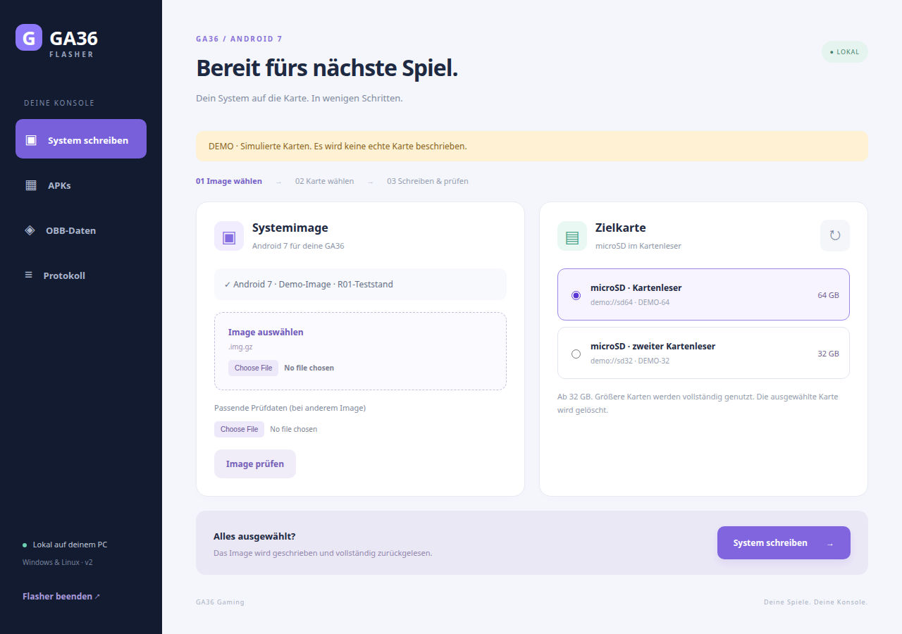
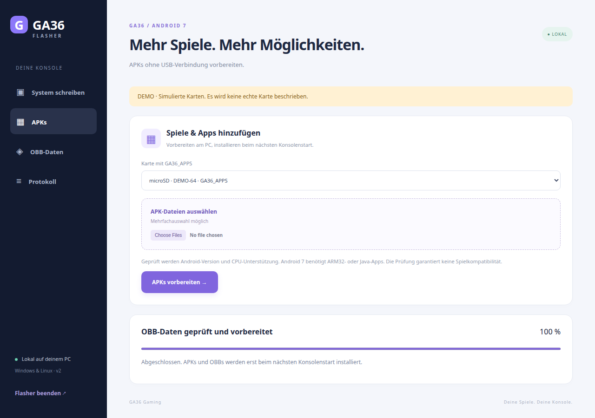

# GA36 Flasher GUI — Windows & Linux

A graphical, offline companion tool for preparing a GA36 Android 7 microSD card and adding APK/OBB files without a USB connection to the handheld.

**Why this tool exists:** USB-to-PC connectivity on this Android port is still unresolved. Connect the microSD card to your PC using a card reader instead. The reader may itself use USB; no USB connection to the handheld is needed. This tool is the card-reader alternative, not a USB fix.

**GUI 2.0 test build · x64 only · No Android image, firmware, games, APKs or OBB data included.** An independently obtained, compatible GA36 R01-format image is required for flashing. This does not make a complete Android release available.

## Download

[Download the Windows + Linux GUI package](GA36-Flasher-GUI-Windows-Linux.zip?raw=true) · [SHA-256 checksum](GA36-Flasher-GUI-Windows-Linux.zip.sha256)

Extract the ZIP before starting. Windows: open `GA36-Flasher-Windows.exe`. Linux: run `GA36-Flasher-Linux` or `Start-Linux.sh` (make executable if needed). The GUI opens in the default browser and runs only on `127.0.0.1`; it does not require internet access. Only the local device service requests administrator privileges. Linux requires `pkexec`, `xdg-open` and `lsblk`. No Go/Python installation is required to run the downloaded program.

## Screenshots



*Actual Linux/Chrome screenshot in safe demo mode. Cards and write operations shown in demo mode are simulated; this is not proof of a physical card write.*



*The APK section prepares installation jobs for the next handheld boot. Current interface labels are German.*

## Write a system card

1. Select a compatible `.img.gz` image and its matching `IMAGE-INFOS.json`, or place both beside the executable. Images are supplied separately.
2. Wait for the image checksum/layout check and select the target card. Check its reader, capacity and serial number.
3. Confirm that the selected card may be erased. All existing data on it will be overwritten.
4. Leave the reader connected until writing and complete readback verification finish, then safely eject through your operating system.

The current implementation supports the **GA36 R01 partition layout only**, with an uncompressed image size of 31,138,512,896 bytes. A marketed 32-GB card must actually meet this minimum; larger cards receive an expanded data partition, with filesystem growth handled by the compatible Android image at first boot. This is not a generic Android flasher. A revised image/layout must be integrated and retested separately.

## APKs and OBB files

Reconnect an existing compatible card and refresh the list. Only its identified `GA36_APPS` import partition is offered.

- **APKs:** choose one or more files. The tool checks minimum SDK and ARM32/Java support; this does not guarantee game compatibility or online services.
- **OBBs:** select the original `main.<version>.<package>.obb` and optional `patch.<version>.<package>.obb` for one game per operation. Keep their names unchanged. The matching APK must be installed or queued separately.
- These actions **prepare** files on the card. The compatible Android-side importer installs APKs and places OBBs under `Android/obb/<package>` on the **next handheld boot**. Selecting files on the PC does not immediately install them on Android.
- Reconnect the card after that boot and use **Protokoll → INSTALL.TXT** to check the result. Ensure sufficient free space on the roughly 4-GB FAT32 import partition.

Existing save data is not erased by the import operation. Writing a fresh system image does erase the whole target card.

## Alternative: install directly on the handheld

You can also copy an APK onto accessible card storage, open it in the handheld’s file manager and follow the Android installer. Allow installation from that source if Android asks. Matching OBB files must be placed separately under `Android/obb/<package>`. This manual route does not require the automatic import service. USB-to-PC connectivity is not required for either route.

## Safe preview

Run `Vorschau-Linux.sh` or `Vorschau-Windows.cmd`. Demo mode uses temporary files and simulated cards, needs no administrator privileges and never writes physical devices.

Use **Flasher beenden** to stop the local service. An idle, unoccupied service also exits after 15 minutes without requests; a running job is not stopped by that timeout.

## Validation and limits

Go unit/integration tests and `go vet` passed. The Linux GUI was exercised in real headless Chrome for card selection, confirmation/cancellation, simulated writes, OBB import, invalid APK rejection, logs, page reload, tabs, small-window layout and shutdown. [Test output](checks/tests.txt) · [Browser check summary](checks/browser-results.json).

The Windows x64 program is cross-compiled; **the project owner also reports that it works on Windows**. Automated GUI checks were run on Linux/Chrome; this is not a claim of exhaustive Windows device/reader coverage. The tool does not fix handheld USB or the second microSD slot.

## Build from source

Go 1.24 or newer is declared; the provided binaries were built with Go 1.27.3. Standard library only, with HTML/CSS/JavaScript embedded into the binary.

```sh
cd tools/flasher/src
go test ./...
go vet ./...
CGO_ENABLED=0 GOOS=linux GOARCH=amd64 go build -trimpath -ldflags="-s" -o GA36-Flasher-Linux .
CGO_ENABLED=0 GOOS=windows GOARCH=amd64 go build -trimpath -ldflags="-s -H=windowsgui" -o GA36-Flasher-Windows.exe .
```

The existing terminal interface remains available with `--console`; `--gui-demo` starts the safe preview.
